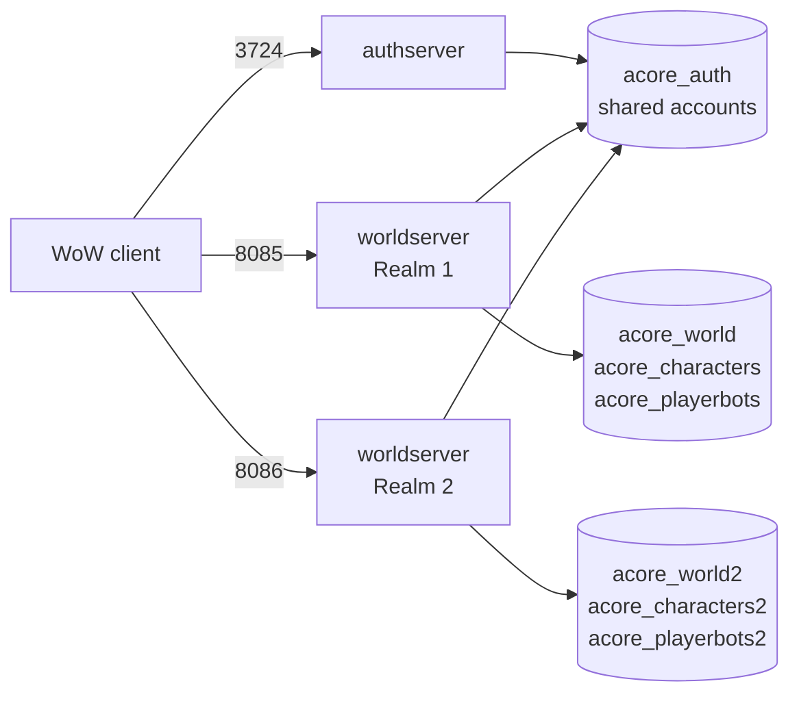

# Two AzerothCore Realms on One Linux Server

A step-by-step guide to running a second AzerothCore realm next to your first one, on the same machine, with a manual (`acore.sh`) build, tmux, and **mod-playerbots**.



**What you end up with:**

- One authserver and two worldservers.
- Shared accounts. Players log in once and see both realms in the realm list.
- Separate characters, guilds, auction houses and playerbots per realm.
- Shared module source code, so module updates are pulled once.

## Why realm 2 needs its own copy

You might expect to start the same `worldserver` binary twice with `-c other.conf`. That works for `worldserver.conf`, but **not for module configs**.

On Linux, worldserver loads module configs (`etc/modules/*.conf`) from the `etc` directory that was compiled into the binary. The `-c` flag does not change that. Two worldservers built from the same copy therefore always read the same `playerbots.conf`, `mod_ahbot.conf` and so on.

For mod-playerbots that is a problem: each realm needs its own playerbots database and its own bot accounts. So realm 2 gets its own copy of AzerothCore, compiled separately. Module **source code** can still be shared with symlinks.

## Assumptions

| Item | Value used in this guide |
|---|---|
| OS | Debian (any Linux works), running as `root` |
| Realm 1 install | `/root/azerothcore-wotlk` (built with `./acore.sh compiler all`) |
| Realm 2 install | `/root/azerothcore-realm2` (created in step 1) |
| Binaries and configs | `env/dist/bin` and `env/dist/etc` inside each install |
| Start script | tmux sessions `auth-session` and `world-session` (`/root/start.sh`) |
| Database user | `acore` |
| Modules | mod-playerbots, mod-ahbot (others work the same way) |

Change the paths if yours differ.

**Hardware:** Each worldserver typically uses 1–4 GB RAM, plus a lot more with many random bots. The guide was tested on a 12-core AMD Ryzen AI 9 HX 370 with 32 GB RAM and 500 bots per realm.

## Step 1: Copy the install

```bash
cp -a /root/azerothcore-wotlk /root/azerothcore-realm2
rm -rf /root/azerothcore-realm2/var/build
```

The second command removes the old CMake build cache. It contains absolute paths to realm 1 and must not be reused.

The copy includes your client data (`dbc`, `maps`, `vmaps`, `mmaps`). That costs a few GB of disk but means `DataDir = "."` keeps working. To save space, see [Share client data](#optional-share-client-data).

## Step 2: Share module source code

Replace each module folder in realm 2 with a symlink to the same module in realm 1:

```bash
bash link-modules.sh
```

Or run it by hand:

```bash
cd /root/azerothcore-realm2/modules && for d in /root/azerothcore-wotlk/modules/*/; do n=$(basename "$d"); rm -rf "$n"; ln -s "${d%/}" "$n"; done
```

Check the result with `ls -l /root/azerothcore-realm2/modules`. Every module folder should show `-> /root/azerothcore-wotlk/modules/...`.

Link the **individual module folders**, not the whole `modules` directory. `modules/` also contains files tracked by AzerothCore's own git repository (such as `CMakeLists.txt`). If the whole folder becomes a symlink, `git pull` in realm 2 can fail.

Only the source code is shared. Module **configs** live in `env/dist/etc/modules/` and stay separate per realm.

## Step 3: Create the databases

Run [`sql/01-create-databases.sql`](sql/01-create-databases.sql) as a MySQL admin user:

```sql
CREATE DATABASE acore_world2       DEFAULT CHARACTER SET utf8mb4 COLLATE utf8mb4_unicode_ci;
CREATE DATABASE acore_characters2  DEFAULT CHARACTER SET utf8mb4 COLLATE utf8mb4_unicode_ci;
CREATE DATABASE acore_playerbots2  DEFAULT CHARACTER SET utf8mb4 COLLATE utf8mb4_unicode_ci;

GRANT ALL PRIVILEGES ON acore_world2.*      TO 'acore'@'localhost';
GRANT ALL PRIVILEGES ON acore_characters2.* TO 'acore'@'localhost';
GRANT ALL PRIVILEGES ON acore_playerbots2.* TO 'acore'@'localhost';
FLUSH PRIVILEGES;
```

Use the same host for `acore` as your existing grants. Check with `SELECT user, host FROM mysql.user;`.

Leave the databases empty. Worldserver fills them on first start, because `Updates.AutoSetup = 1` (worldserver) and `Playerbots.Updates.EnableDatabases = 1` (playerbots) are on by default.

## Step 4: Edit worldserver.conf

Edit `/root/azerothcore-realm2/env/dist/etc/worldserver.conf`:

| Setting | Realm 1 | Realm 2 |
|---|---|---|
| `RealmID` | `1` | `2` |
| `WorldServerPort` | `8085` | `8086` |
| `LoginDatabaseInfo` | `...;acore_auth` | `...;acore_auth` (unchanged, shared) |
| `WorldDatabaseInfo` | `...;acore_world` | `...;acore_world2` |
| `CharacterDatabaseInfo` | `...;acore_characters` | `...;acore_characters2` |
| `Ra.Port` | `3443` | `3444` |
| `SOAP.Port` | `7878` | `7879` |
| `LogsDir` | `""` | `"logs-realm2"` |
| `PidFile` | `""` | `"worldserver-realm2.pid"` |

`Ra.Port` and `SOAP.Port` only matter if RA or SOAP is enabled, but changing them avoids a port clash later.

Create the log folder:

```bash
mkdir -p /root/azerothcore-realm2/env/dist/bin/logs-realm2
```

## Step 5: Edit playerbots.conf (and other module configs)

Edit `/root/azerothcore-realm2/env/dist/etc/modules/playerbots.conf`:

| Setting | Realm 1 | Realm 2 |
|---|---|---|
| `PlayerbotsDatabaseInfo` | `...;acore_playerbots` | `...;acore_playerbots2` |
| `Playerbots.RandomBotAccountPrefix` | `"rndbot"` | `"botr2"` |

**Pick a prefix that does not start with the realm 1 prefix.** Bot accounts are created in the shared `acore_auth` database. A prefix like `rndbot2` starts with `rndbot`, so realm 1 can mistake realm 2's bot accounts for its own. Use something different, such as `botr2`.

Do not change the prefix on a realm that already has bot accounts.

If the server gets slow, lower `Playerbots.MinRandomBots` and `Playerbots.MaxRandomBots` on realm 2. Two realms with 500 bots each means 1000 bots in total.

**mod-ahbot:** The auction house bot is tied to a specific account and character. Characters are per realm, so create an AH bot character on realm 2 and set its account and character in realm 2's `mod_ahbot.conf`.

**Other modules:** Check every config in `env/dist/etc/modules/` for database names, account IDs or character GUIDs that should differ on realm 2.

## Step 6: Register the realm

Run [`sql/02-add-realm.sql`](sql/02-add-realm.sql) after changing the name and address:

```sql
INSERT INTO acore_auth.realmlist (id, name, address, localAddress, localSubnetMask, port)
VALUES (2, 'My Second Realm', 'YOUR.PUBLIC.IP.OR.HOSTNAME', '127.0.0.1', '255.255.255.0', 8086);
```

`id` must match `RealmID` from step 4. `address` is what players outside your network connect to.

Open the new port if you use a firewall:

```bash
ufw allow 8086/tcp
```

## Step 7: Compile realm 2

```bash
cd /root/azerothcore-realm2 && ./acore.sh compiler all
```

This builds against realm 2's own paths, so its binary reads configs from `/root/azerothcore-realm2/env/dist/etc`.

## Step 8: Start script and aliases

Copy [`start2.sh`](start2.sh) to `/root/start2.sh`. It starts realm 2's worldserver in a tmux session called `world2-session`. It does **not** start authserver, because your existing `start.sh` already does.

Add the aliases from [`aliases.sh`](aliases.sh) to `~/.bashrc` and run `source ~/.bashrc`:

| Alias | What it does |
|---|---|
| `start2` | Start realm 2 |
| `wow2` | Attach to realm 2's console (detach with `Ctrl+B`, then `D`) |
| `stop2` | Shut realm 2 down gracefully (players are saved) |
| `update2` | Pull realm 2's core |
| `compile2` / `build2` | Full build / build only |
| `world2` / `pb2` / `ah2` | Edit realm 2's worldserver / playerbots / ahbot config |

Start both realms:

```bash
start; start2
```

Realm 2 must start **after** authserver is running, or it will not appear in the realm list.

The first start takes a while: the databases are populated and the bot accounts are created.

## Updating both realms

Modules are shared, but each core is pulled and compiled separately. Always update both cores together:

```bash
update        # pull realm 1 core + playerbots
updatemods    # pull all modules (shared by both realms)
update2       # pull realm 2 core
compile       # build realm 1
compile2      # build realm 2
```

If you only update realm 1 and then run `compile2`, realm 2 is built with new modules against an old core. mod-playerbots is tightly tied to its core version, so that can break the build.

**New module:** clone it into realm 1's `modules/`, then run `link-modules.sh` again so realm 2 gets the symlink.

## Optional: share client data

Instead of keeping two copies of the client data, delete realm 2's copy and symlink realm 1's:

```bash
cd /root/azerothcore-realm2/env/dist/bin
for x in dbc maps vmaps mmaps Cameras; do rm -rf "$x"; ln -s "/root/azerothcore-wotlk/env/dist/bin/$x" "$x"; done
```

This assumes the data lives next to the binaries (`DataDir = "."`). Adjust the path if yours is elsewhere.

## Troubleshooting

| Symptom | Likely cause |
|---|---|
| Realm 2 is not in the realm list | No row in `acore_auth.realmlist`, or `id` does not match `RealmID` |
| Realm 2 shows as offline | Worldserver not running, wrong `port` in `realmlist`, or port 8086 blocked |
| `Address already in use` on start | `WorldServerPort`, `Ra.Port` or `SOAP.Port` still the same as realm 1 |
| Both realms share bots or bot settings | Realm 2 started from realm 1's binary, or the same `playerbots.conf` |
| Bots log in on the wrong realm | Bot account prefixes overlap (see step 5) |
| `start2.sh: $'\r': command not found` | The script was saved with Windows line endings. Fix with `sed -i 's/\r$//' /root/start2.sh` |
| Build errors after updating | Cores and modules out of sync. Run `update`, `updatemods`, `update2`, then compile both |
| `Applying of file '.../modules/<module>/.../updates/....sql' to database '..._2' failed!` | A module update runs before the module's base SQL on a fresh database. See [below](#module-update-fails-on-a-fresh-realm-2-database) |

### Module update fails on a fresh realm 2 database

Example:

```
Applying of file '/root/azerothcore-realm2/modules/mod-levelsync/data/sql/characters/updates/2026_05_03_00_add_founder_guid.sql' to database 'acore_characters2' failed!
```

**Why:** The auto-updater runs a module's SQL files sorted by file name, not base first. A dated update such as `2026_05_03_00_add_founder_guid.sql` sorts before a base file such as `mod_levelsync_tables.sql`. On realm 2's empty database the update tries to change a table that does not exist yet. Realm 1 never hit this because its tables were created before the update existed.

**Fix:** Apply the module's base SQL to realm 2's database by hand, then start realm 2 again:

```bash
mysql -u acore -p acore_characters2 < /root/azerothcore-realm2/modules/mod-levelsync/data/sql/characters/base/mod_levelsync_tables.sql
```

Swap in the module, database and base file from your error. Check the base file first: this is only safe when it uses `CREATE TABLE IF NOT EXISTS`, because the updater will run it again later. A failed update is not recorded, so it is retried on the next start.

If it still fails, the MySQL error is in the log lines just above `failed!`. Consider reporting the ordering problem to the module's author.

## Notes

- `tmux kill-server` (a common `stop` alias) kills **every** session, including authserver and both realms, without saving players. Prefer a graceful shutdown: attach to the realm and type `server shutdown 10`, or use `stop2`.
- The default AzerothCore database password is `acore`. Change it if your database is reachable from outside the server.
